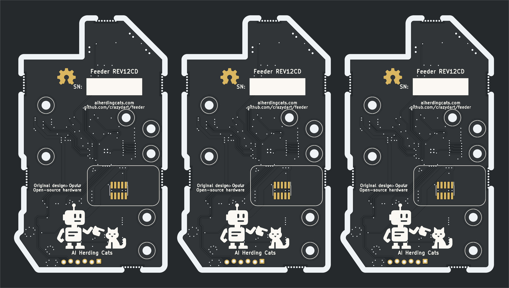

# Feeder REV12CD

Public hardware fork maintained by **crazydart**, derived from [Opulo's feeder repository](https://github.com/opulo-inc/feeder). **REV12CD removes the alternate U2 MCU and keeps U1 (STM32F031C6T6, LQFP-48).** The single board and all three panel copies are labeled REV12CD.

| File | Purpose |
|---|---|
| [Single-board KiCad project](pcb/mobo/mobo.kicad_pro) | Editable circuit and PCB |
| [Three-board KiCad project](pcb/mobo-panel3/feeder-rev12cd-panel3.kicad_pro) | Editable routed panel |
| [JLCPCB upload ZIP](pcb/mobo-panel3/feeder-rev12cd-panel3-jlcpcb.zip) | PCB, drills and both stencil paste layers together |
| [PCB order notes](pcb/mobo-panel3/ORDER-NOTES.md) | Settings and short order comment |
| [Stencil and PnP data](pcb/mobo-panel3/STENCIL-AND-PNP.md) | Stencil settings and saved machine coordinates |
| [Panel documentation](pcb/mobo-panel3/README.md) | Reproduction steps and validation results |

The panel is 184 × 104 × 1.6 mm, with three boards and six drilled breakaway tabs per board. The top/bottom tabs and four side tabs avoid the connectors and buttons.

Modified 2026-10-11 from upstream commit `05843dd0e7551cbf20dc831514174f446f376858`. Checks found no new electrical DRC errors, unconnected items or single-board schematic/PCB mismatches. Inherited DRC/ERC findings are documented in the [single-board notes](pcb/mobo/README.md) and [panel validation reports](pcb/mobo-panel3/validation). This derivative has not been physically prototyped.

Hardware remains under CERN-OHL-W v2; see [LICENSE](LICENSE). The modified PCBs use AI Herding Cats branding and credit Opulo for the original design. Other upstream designs and documentation remain below.

## Accessories

- [Gridfinity holder for 8 mm feeders](cad/accessories/gridfinity-8mm-holder/README.md) — five slots on a 5 × 3 base, with STL and editable OpenSCAD source. Prototype 06 provides 10 mm of feeder lift and 4 mm radial rear relief for mounted reels; revised reel clearance awaits a physical fit check.
- [Gridfinity holder for 16 mm and 24 mm feeders](cad/accessories/gridfinity-2u-holder/README.md) — four slots on a 5 × 4 base, rendered with both 2u feeder models. Physical fit is untested.
- [Integrated spool arm and threaded thimble](cad/accessories/threaded-thimble/README.md) — removes the detachable thimble connector and adds 2 mm of reel space. Reuses the tested retaining screw with its 30 × 3 mm head; the new arm's physical fit is untested.

## Parts sourcing

- [Feeder motor sourcing](docs/motor-sourcing.md) — motor specifications, supplier URLs, fit and wiring details, and the October 16, 2026 checkout costs for comparing direct imports with the Opulo kit.

## Upstream LumenPnP Feeders
The LumenPnP Feeders are open source pick and place feeders to aid in [Mid-Scale Manufacturing](https://stephenhawes.com/level-2-manufacturing/).

LumenPnP Feeders are available for sale on the [Opulo Website](https://www.opulo.io/). If you build or buy one, please help the project by documenting bugs with a GitHub issue.

The LumenPnP Feeders run [Photon](https://github.com/photonfirmware/photon), an open source firmware project for pick and place feeders. The popular pick and place control software [OpenPnP](https://openpnp.org/) has Photon support built in, so it's easy to get going with the LumenPnP feeders using your existing OpenPnP setup. These feeders are designed to work with the [LumenPnP](https://opulo.io/products/lumenpnp).

The development process is being cataloged in a series of videos. A playlist of these can be found [here](https://www.youtube.com/playlist?list=PLIeJXmcg1baLBz3x0nCDqkYpKs2IWGHk4).

## Documentation
Feeder user documentation can be found on the [Opulo Docs Page](https://docs.opulo.io/). Open Hardware Assembly instructions can be found at [ohai.opulo.io](https://ohai.opulo.io/).

## Community
Discussion about the project happens on the [STR Discord server](https://discordapp.com/invite/TCwy6De)!
