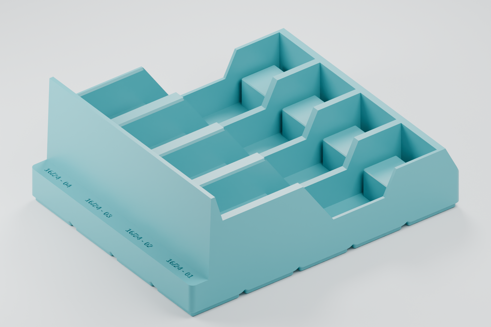
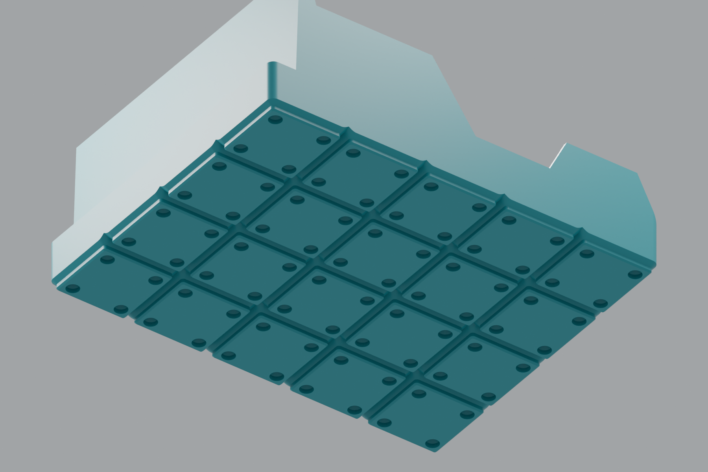

# Gridfinity holder for 16 mm and 24 mm feeders — prototype 02

Four upright Opulo 2u feeders on a 5 × 4 Gridfinity footprint. These renders
use the saved 16 mm and 24 mm feeder CAD, with a cradle designed around their
lower frames, wider PCB assemblies and release levers. Physical fit, insertion
and release-lever movement have not been tested.

Both feeder sizes share the support surfaces used by this holder. Every slot
is marked **16/24**, followed by its slot number. One shared STL accommodates
either size in any slot. Prototype 02 updates the engraving; the cradle and
base retain the reviewed prototype 01 geometry.

## Print files

- [Shared 16/24 mm holder STL](stl/gridfinity-16-24mm-holder-4-slot-prototype-02.stl)

This binary STL includes all four slots and the shared engraved labels.
Import in millimeters at 100% scale: **209.5 × 167.5 × 85 mm**.
The feet are already at Z = 0 for feet-down printing. The file is one closed
solid, with the vaulted underside and magnet pockets included. The geometry
is intended for printing with supports disabled; physical fit remains untested.

## Preview



Earlier fit renders show the same cradle with superseded size-only labels:
[16 mm loaded](renders/prototype-01/16mm/01-loaded.png),
[16 mm section](renders/prototype-01/16mm/03-side-section.png),
[24 mm loaded](renders/prototype-01/24mm/01-loaded.png), and
[24 mm section](renders/prototype-01/24mm/03-side-section.png).

## Geometry and print orientation

| Feature | Prototype value |
| --- | --- |
| Gridfinity footprint | 5 × 4 cells |
| Outside dimensions | 209.5 × 167.5 × 85 mm |
| Feeder capacity and pitch | Four, 42 mm centers |
| Front channel width | 32.45 mm, around a 30.85 mm frame |
| PCB and lever pocket width | 37.2 mm |
| Front housing seat | Z = 39 mm; source frame underside Z = −30 mm |
| Rear frame seat | Z = 29 mm; source frame underside Z = −40 mm |
| Rear seat footprint | Source X = 40–66 mm, Y = 3–29 mm, with rounded corners and a top chamfer |
| Lowest pocket floor | Z = 9 mm |
| Reference assembly placement | X + 15.5 mm, Y − 13.25 mm + lane center, Z + 69 mm |
| Optional magnet pockets | Ø6.5 × 2.4 mm bore plus a 45° conical roof; four per cell |

The front housing rests on its flat underside. The rear pad supports the
plastic behind the PCB, beyond the release lever, leaving a deep central
pocket for the latch. Side guides retain the front frame and the wider rear
envelope. The upper mechanisms remain accessible.

Print feet-down. The base carries over the pointed vaults between feet and
conical magnet-pocket roofs from the 8 mm prototype. Lead-in chamfers remain
open through the tall front stop. The standard 4.75 mm foot mating profile
and 42 mm grid pitch are retained. There is no stacking lip.

The shared export is one closed solid. The prototype 01 cradle geometry passed
18 sampled front/rear contact checks for each feeder size, with 5.05 mm of static
X separation between the rear pad and release lever. Screening found no
intersections over 0.01 mm³ among
72 closed reference parts for the 16 mm model and 71 for the 24 mm model, in all
four lanes; six non-volume meshes per variant were excluded. The underside
check found zero elevated horizontal undersides and a minimum slope of 45°,
with 2.34 mm of sampled skin above the widest vault crowns. Full results and
the excluded parts are recorded in `generated/geometry-check-16.json` and
`generated/geometry-check-24.json`.

The prototype 02 export was rechecked for dimensions, a single closed solid
and the 45° minimum underside slope, with zero elevated horizontal underside
area. Those results are in `generated/export-check-prototype-02.json`.



## Source and limitations

Upstream source is pinned to
[`opulo-inc/feeder`, commit `e96d03c`](https://github.com/opulo-inc/feeder/tree/e96d03cb3d28bcb62ed9e09e28752d2cbe735102),
from its `2u` branch. The source assemblies are `cad/asm-16mm.FCStd` and
`cad/asm-24mm.FCStd`. Source files are read from Git without switching branches
or changing the inherited 8 mm CAD in this fork.

The upstream assemblies contain obsolete references. Two gear filenames are
mapped to the current `peel-gear-2u-bottom` and `peel-gear-2u-top` files, retaining
the saved assembly placements. Missing old cover links are omitted because a
valid `drive-motor-cover-2u` link is present; the 24 mm assembly's missing old
frame link is omitted because a valid `frame-24` link is present. These choices
are recorded in each reference manifest. The assembly's remaining links are
used as saved, including its referenced worm gear.

The reference assemblies do not fully model motors, fasteners or wiring. Some
PCB meshes are not closed solids. The checks therefore screen the closed parts
in all four seated positions and sample actual frame contact surfaces, but do
not establish complete mechanical or physical compatibility. Check a printed
cradle with the real feeder and baseplate before producing a full set.

## Files and reproduction

- `holder.scad`: shared cradle and printable base, with 16/24 labels.
- `stl/`: one shared binary print export.
- `tools/export_feeders.py`: pinned upstream BRep and placement extraction.
- `tools/export_holders.py`: binary STL export with collapsed triangles removed.
- `tools/check_geometry.py`: mesh, underside, support-contact and interference checks.
- `tools/render.py`: Blender scene and images for each feeder variant.
- `renders/prototype-02/`: current shared-label preview.
- `renders/prototype-01/`: earlier model-derived fit review images.
- `generated/`: ignored meshes, manifests, check reports and Blender scenes.

From this directory, with `uv`, OpenSCAD and Blender installed, and an upstream
Git checkout containing the pinned commit:

```sh
uv run --python 3.11 tools/export_feeders.py /path/to/upstream/feeder
uv run --python 3.11 tools/export_holders.py
uv run --python 3.11 tools/check_geometry.py
blender --background --python tools/render.py -- 16 final
blender --background --python tools/render.py -- 24 final
```

On macOS, Blender may be at `/Applications/Blender.app/Contents/MacOS/Blender`.
Editable scenes are saved as `generated/prototype-02-16.blend` and
`generated/prototype-02-24.blend`. Each loaded view shows three feeders so the
fourth, empty cradle is visible. Render-only edge highlights do not alter the STL.

This accessory follows the repository's CERN-OHL-W v2 hardware license.
