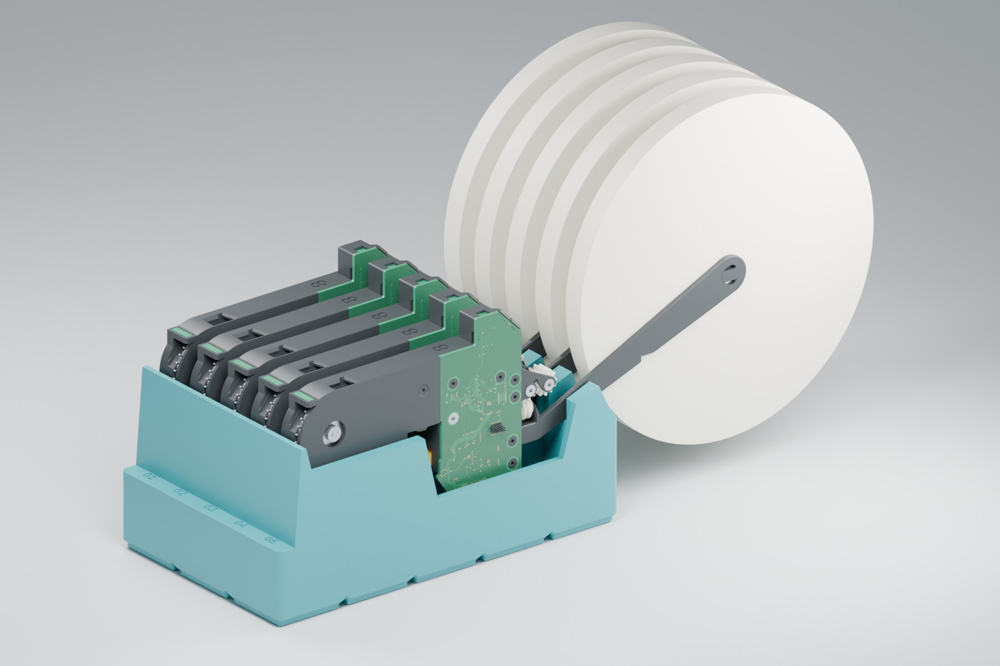
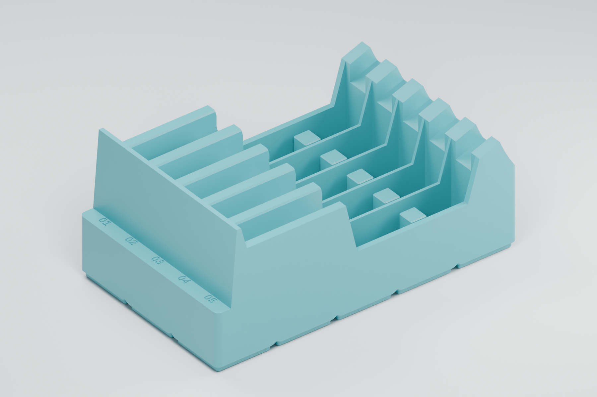
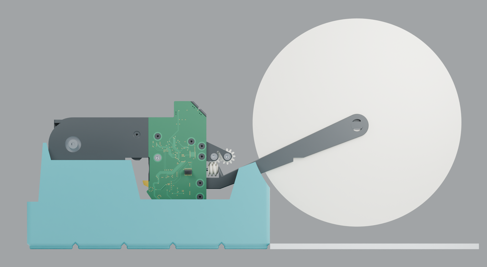

# Gridfinity holder for 8 mm feeders — prototype 06, reel clearance

Five upright 8 mm (1u) feeders in parallel cradles on the same 5 × 3 Gridfinity
footprint. Based on the supplied storage sketches and this repository's saved
`cad/assembly-8.FCStd` geometry.

Prototype 06 doubles the rear reel relief from **2 mm to 4 mm radial
clearance**, allowing more room for variation in reel size. It retains the
**10 mm** feeder lift introduced in prototype 05. The footprint,
five slots at 24 mm centers, channel widths and Gridfinity feet are retained.
The pocket floor stays at Z = 9 mm, avoiding an extra solid slab beneath it.

The October 19 print photos showed that small reels cleared prototype 04,
while a larger reel hit the rear cradle and reached the tabletop. The user
requested about 10 mm of extra clearance. Prototype 06 has passed CAD and
slicing checks; the revised clearance still needs checking on the physical print.





## Reel clearance

The current envelope is **180 mm outside diameter × 12 mm wide**, pending
measurement of the photographed reel. The repository's `cad/REF/spool.FCStd`
contains a simpler 177 mm × 10 mm reference. The assumed reel axle follows the
saved feeder CAD at X = −179.9 mm and source Z = 30.5 mm. Its inner flange is
placed 0.15 mm from the arm face. Reels in the renders are annular envelopes,
not detailed models of the user's reels.

Raising the whole cradle alone would retain the rear interference. A circular
relief with 4 mm radial allowance opens the rear rail and arm channel beneath
the reel. The forward arm seat remains; nine samples from X = −94 to −80 mm
retain approximately 0.10 mm relief below the saved arm surface. The lower
frame support behind the PCB rises with the feeder.



The strip under the reel in this view represents a nominal baseplate top
4.75 mm above the holder's foot-bottom datum; it is not a baseplate model.
The assumed reel clears this plane by 14.75 mm in the saved CAD pose. The
reliable change from prototype 04 is **10 mm of additional vertical lift**;
the absolute physical gap depends on the actual reel, arm position and baseplate.
Adjust `reel_diameter` if the measured reel is larger, then rerun export and checks.

The earlier [base section](renders/prototype-03/05-base-section.png) shows the
retained pointed vaults and conical magnet-pocket roofs. Earlier
prototype images remain in their original render directories.

## Print geometry

The print export is
[gridfinity-8mm-holder-5-slot-reel-clearance-prototype-06.stl](stl/gridfinity-8mm-holder-5-slot-reel-clearance-prototype-06.stl).
It is a binary STL containing one closed solid, exported in millimeters, with
the feet already at Z = 0. Import at 100% scale: 209.5 × 125.5 × 92 mm.
Use feet-down orientation and disable supports. The slicing check
used a 0.4 mm nozzle, 0.2 mm layers, three walls and 15% gyroid infill.

The previous [2 mm relief prototype 05 STL](stl/gridfinity-8mm-holder-5-slot-reel-clearance-prototype-05.stl),
[five-slot prototype 04 STL](stl/gridfinity-8mm-holder-5-slot-prototype-04.stl)
and [four-slot prototype 03 STL](stl/gridfinity-8mm-holder-4-slot-prototype-03.stl)
are retained for reproducing the earlier prints.

Print with all 15 Gridfinity feet on the bed. The exported mesh has zero
horizontal downward-facing surface area above the build plate; every elevated
underside is at least 45° from horizontal, within numerical tolerance.

- Adjacent feet expand at 45° above the 4.75 mm mating profile, meeting in
  pointed vaults. The former flat ceilings between feet are removed.
- Each magnet pocket has a 45° conical roof above its straight bore.
- Front channel entrance flares continue through the tall end stop, removing
  the small blind ledges that previously occurred there.
- The lowest pocket floor is now 9 mm above the bed. At the eight intersections
  where four feet meet, the sampled material thickness above the vault crowns
  is 2.34 mm. Cradle seats and feeder placement rise together by 10 mm over
  prototype 04, while the base and floor retain their previous heights.

The base section image cuts through two feet and their magnet centers; the
triangular openings are sectioned voids, not extra holes in the outer wall.
The conical roofs provide clearance above the magnets; pocket fit and magnet
seating depth still need checking on a print.

These are geometric checks for a design intended to print without supports.
Actual overhang quality depends on the printer, cooling, material and settings;
see [Prusa's modeling guidance](https://help.prusa3d.com/article/modeling-with-3d-printing-in-mind_164135).

## Geometry

| Feature | Prototype value |
| --- | --- |
| Gridfinity footprint | 5 × 3 cells |
| Holder outside dimensions | 209.5 × 125.5 × 92 mm |
| Feeder positions | Five, on 24 mm centers |
| Front channel | 16.4 mm, around the nominal 15 mm plastic frame |
| Electronics/latch pocket | 22 mm wide, floor at Z = 9 mm |
| Electronics pocket dividers / outer walls | 2 mm / 3.75 mm |
| Minimum separation of adjacent feeder Y envelopes | 2.8 mm in the reference CAD |
| Minimum side clearance at the low electronics rails | 2.05 mm in the reference CAD |
| Rear arm channel | 14 mm wide, sloped seat with open rear reel relief |
| Front housing seat | Z = 59 mm |
| Support under the lower PCB corner | 11 × 11.5 mm footprint; seat at Z = 39 mm; 0.6 mm top chamfer |
| New support position along feeder | Source X = −49 to −38 mm, beneath the plastic frame |
| Support separation from lever / PCB | At least 3.07 mm along X from lever; 0.95 mm along Y from PCB, in the saved pose |
| Feeder reference placement | Assembly Z + 79 mm; frame centered in each lane |
| Lowest latch clearance | Approximately 12.5 mm above the pocket floor in the saved pose |
| Overall occupied length | Approximately 295 mm with arms, 375 mm with assumed 180 mm reels |
| Optional magnet pockets | Ø6.5 × 2.4 mm straight bore, plus 3.25 mm high conical roof; four per cell, enabled |

The plastic front housing carries the feeder on its flat underside. A second
seat follows the underside of the spool arm, with 0.1 mm nominal relief. The
middle pocket gives the PCB, yellow release latch, gears and wiring space.
The added ledge rises from that pocket floor to contact the flat plastic frame
underside behind the PCB. Its outer edge stays inboard of the board itself.
The front end wall limits forward travel. Each slot is numbered on the front
ledge. The arms and mounted reels extend beyond the rear edge. Only the holder
is included in the print STL; reel and feeder meshes are references.

The base uses the 42 mm pitch and 41.5 mm single-cell envelope documented in
the [community Gridfinity specification](https://github.com/gridfinity-unofficial/specification).
Feet have a 0.8 mm lower chamfer, 1.8 mm straight section and 2.15 mm upper
chamfer, with a 35.6 mm bottom and 41.5 mm top. These dimensions were cross-checked
against an [independent implementation](https://github.com/IamMrCupp/clickfinity-openscad).
The footprint has 0.25 mm clearance per outer side. There is no stacking lip.

## Files and reproduction

- `holder.scad`: editable, parametric holder source in millimeters.
- `stl/gridfinity-8mm-holder-5-slot-reel-clearance-prototype-06.stl`: named binary print export
  of the current source, including the frame supports and magnet pockets.
- `stl/gridfinity-8mm-holder-5-slot-prototype-04.stl`: earlier five-slot print.
- `stl/gridfinity-8mm-holder-4-slot-prototype-03.stl`: previous four-slot print.
- `tools/export_holder.py`: exports and verifies the named binary STL.
- `tools/model_parameters.py`: reads evaluated OpenSCAD dimensions for checks and renders.
- `tools/export_feeder.py`: extracts saved FreeCAD BReps and applies assembly
  placements to generate feeder reference meshes. Uses `uv` script dependencies.
- `tools/render.py`: Blender scene builder for the five-slot prototype.
- `tools/check_geometry.py`: checks underside slopes, vault skin thickness,
  frame support contact and seated mesh interference.
- `renders/`: review images generated from the model, rather than drawn mockups.
- `generated/`: ignored intermediate meshes, Blender scene and check report.

From this directory, with `uv`, OpenSCAD and Blender installed:

```sh
uv run --python 3.11 tools/export_feeder.py
uv run --python 3.11 tools/export_holder.py
uv run --python 3.11 tools/check_geometry.py
blender --background --python tools/render.py -- final
```

On macOS, the Blender executable may be
`/Applications/Blender.app/Contents/MacOS/Blender`. The saved scene is
`generated/prototype-06.blend`. The loaded view shows all five feeders and assumed reels; the
empty view exposes all five cradles.

## Checks and remaining fit work

The exported holder is a single, closed, consistently oriented mesh at the
dimensions above. Mesh interference screening checks closed feeder reference
parts in all five seated positions. Its report lists any source meshes that
cannot participate in that check; it is not a complete mechanical validation.
The new ledge is also checked against the actual frame surface at nine sampled
contact points, plus static separation from the lever and PCB envelopes.
For prototype 06, the check passed for all nine frame contact samples and found no
intersections larger than 0.01 mm³ among the 85 closed reference parts in five
lanes. Ten non-volume source meshes are excluded from volume screening.
An envelope check includes all source meshes: their 21.2 mm overall width
leaves at least 2.8 mm between neighboring feeder envelopes at 24 mm pitch.
All parts reaching the low electronics rails have at least 2.05 mm of side
clearance inside the electronics pockets. Additional checks cover nine arm-seat
samples and the assumed reel envelope against the holder in all five lanes.
These are static checks, without external wiring, loaded arm deflection or
loaded-holder stability validation.

A local Bambu Studio 02.07.00.55 check sliced the model feet-down into 460 layers
with supports disabled, using an example X1 Carbon 0.4 mm nozzle profile,
Generic PLA, 0.2 mm layers, three walls and 15% gyroid infill. It produced no
support toolpaths or plate warnings and exported a valid 3MF with exit code 0.
The CLI also emitted nonfatal `ZFiller` clipping diagnostics, preserved in
`generated/slice-check-prototype-06/slicer.log`; the verification summary is
in that same ignored directory. The example settings are retained in
`generated/slice-check/`. This example profile has not been selected for the
user's printer.

The feeder meshes come from the inherited mechanical assembly and PCB model;
they do not represent a new export of the REV12CD electronics. Two broken links
already present in the saved assembly are omitted. The valid replacement spool
arm is included. The joint object has no render geometry.

The user's earlier prints provide fit feedback for the channel dimensions.
Prototype 06 still needs a physical check with the largest intended reel,
installed PCB and wiring, latch movement, insertion and removal, and the
intended Gridfinity baseplate.

This accessory follows the repository's CERN-OHL-W v2 hardware license.
