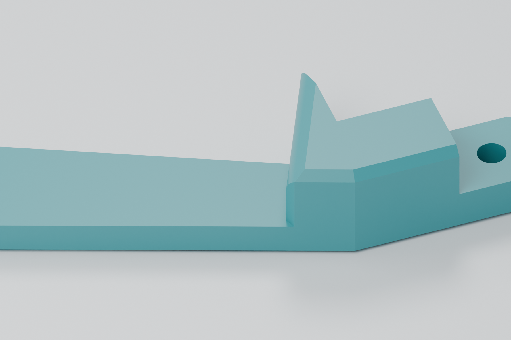
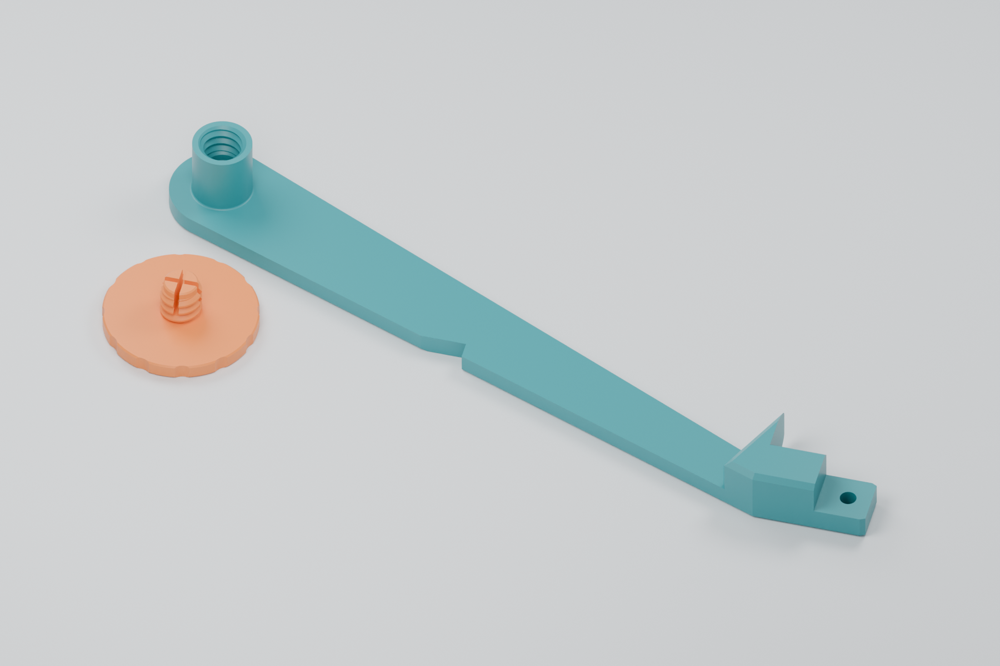
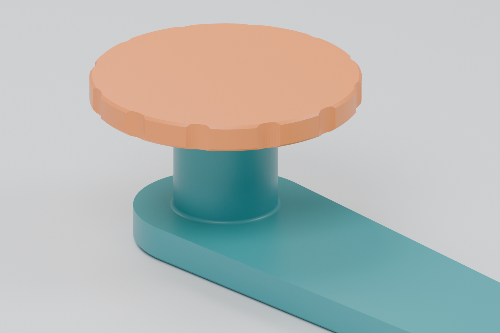
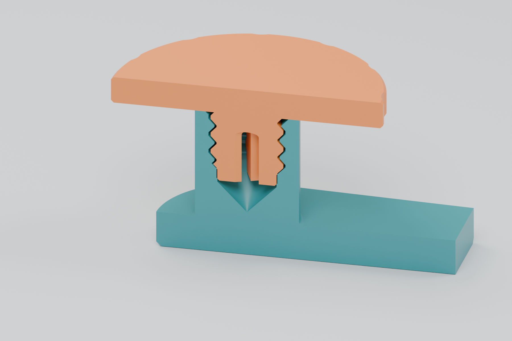

# Continuous 4 mm spool arm and threaded thimble — prototype 04

The arm is now **4 mm thick all the way to the cover-tape guard**, with no
ramp or thin neck at its connection to the feeder. The raised guard keeps the
peeled cover tape out of the gears. Its upper geometry and the feeder mounting
features are preserved. **Reuse the existing retaining screw.**



| Part | File | Overall print dimensions |
|---|---|---|
| Continuous 4 mm arm with integral threaded thimble | [Print STL](stl/spool-arm-continuous-4mm-integrated-thimble-prototype-04.stl) | Approximately 150 × 65 × 16.4 mm |
| Existing retaining screw, unchanged | [STL if another is needed](stl/reel-retaining-screw-30mm-prototype-01.stl) | 30 × 30 × 11 mm; head is 3 mm thick |

Geometry, saved assembly clearance and slicing checks pass. The revised arm's
loaded stiffness still needs a physical print test.

## Arm and reel fit

- **Continuous 4 mm arm:** 1.5 mm of reinforcement follows the original
  2.5 mm beam, retaining its outline and notch. It extends into the diagonal
  guard junction so the entire free span reaches full thickness. The original
  lower perimeter chamfer remains; there is no tapered upper face.
- **12.4 mm usable reel space**, unchanged from prototype 03 and 1 mm less
  than prototype 02. A modeled 12 mm wide reel has 0.4 mm total axial play;
  actual clearance depends on the reel and printing accuracy.
- Reinforcement is on the reel side, preserving the flat print underside.
  Compared with prototype 03, both the reel contact face and the complete
  threaded bore move inward by 1 mm. Their separation and screw engagement
  remain unchanged.
- The raised tape guard above the new beam face is unchanged. The feeder
  attachment beyond native X = 116 mm is unchanged. Added material clears
  nearby gears and the motor in the saved 8 mm feeder assembly position.
- The spindle remains 11.5 mm in diameter with a 0.4 mm root fillet. Its maximum
  root diameter is 12.3 mm, inside the reference reel's 13.3 mm hub bore. The
  former detachable socket remains filled through the arm.
- The screw STL is byte-for-byte identical to the physically tested screw,
  including its **30 mm diameter, 3 mm thick head** and split pilot retention
  feature.



The threads remain a custom **8 mm major diameter × 2 mm pitch**, single-start,
right-hand printed pair, not an ISO M8 interface. Thread clearance and the
pilot/collar interference are unchanged.





These renders use the actual STL geometry. The section shows the split pilot
in its undeformed shape; its small collar interference is intentional.

## Printing and installation

- Print at **100% scale, long flat back on the bed and thimble opening upward**,
  as supplied. The checked layout needs no supports.
- Keep the same calibrated PETG material profile used for the earlier design.
  Starting settings are a 0.4 mm nozzle, 0.16 mm layers, four walls, five top
  and bottom layers, and dense infill. Validation used 99% infill.
- If another screw is needed, print its large head flat on the bed, with the
  stem pointing upward. The supplied screw STL already has that orientation.
- Replace the previous spool arm using the existing feeder attachment. Clean
  any strings from the bore and seat the existing screw gently by hand.
- Check free reel rotation and loaded arm flex. Test retention over a table
  before moving feeders around; do not force the cap if a wider reel is clamped.

Neighboring feeder spacing remains outside this revision's scope, as requested.
Assembly checks cover the saved position; they do not establish clearance
through every moving part's travel or under loaded deflection.

## Source and reproduction

[integrated-arm.scad](integrated-arm.scad) adds reinforcement to the saved arm
mesh and uses the tested bore from [thimble.scad](thimble.scad).
`spindle_extension = 1` specifies usable space relative to the original
11.4 mm baseline; `reinforcement_height = 1.5` adds arm thickness separately.
Reinforcement overlaps the guard to native X = 116 mm, beyond the diagonal
end of the original low beam at X = 115.225 mm.
The checked-in [arm reference](reference/spool-arm.stl) permits an OpenSCAD
build without FreeCAD.

From this directory:

```sh
# Build prototype 04 and the unchanged screw.
python3 tools/build.py
uv run tools/check_integrated_arm.py

# Generate saved assembly meshes, then screen added material for collisions.
uv run ../gridfinity-8mm-holder/tools/export_feeder.py
uv run tools/check_feeder_clearance.py

# Render the actual exported STLs.
blender --background --python tools/render_integrated_arm.py
```

OpenSCAD with the Manifold backend is required. Reference export reads saved
FreeCAD BReps using pinned OCP dependencies through `uv`. Refresh the arm mesh
with `uv run tools/export_reference.py` only when its source CAD changes.
The STL builder removes exactly zero-area export facets without moving vertices.

[validation-prototype-04.json](validation-prototype-04.json) records STL hashes,
geometry measurements, assembly checks and slicing results. Checks cover one
connected watertight solid, print orientation, practical overhangs, preservation
of the raised guard and feeder attachment, eight beam sections, reinforcement
across the entire original low beam footprint, unchanged 12.4 mm reel space,
unchanged screw geometry, 17 screw positions and a 12 mm wide reel.
Float32 sliver faces narrower than 0.00001 mm are excluded from the overhang
angle calculation; their total area is separately bounded and recorded.

Bambu Studio sliced the arm using an X1 Carbon 0.4 mm nozzle profile, PETG and
supports disabled. No support paths were generated. Machine-specific G-code
and expanded profiles stay in ignored `generated/`; slice the STL for your printer.

## Previous versions

- [Prototype 03](prototype-03.md): 5 mm free span tapering to the original
  2.5 mm beam before the guard. Prototype 04 removes that thin transition
  and sets the whole free span to 4 mm. Source and STL are retained;
  reproduce with `python3 tools/build.py --prototype 03`.
- [Prototype 02](prototype-02.md): integrated thimble, 13.4 mm reel space and
  original 2.5 mm arm. Physical testing found excess reel play and arm flex.
  Reproduce with `python3 tools/build.py --prototype 02`.
- [Prototype 01](prototype-01.md): superseded detachable thimble. The connector
  failed the physical fit test; its screw remains current. Reproduce with
  `python3 tools/build.py --legacy`.

Modified 2026-10-20 from the repository's Opulo thimble and spool-arm design.
Hardware remains under the repository's [CERN-OHL-W v2 license](../../../LICENSE).
