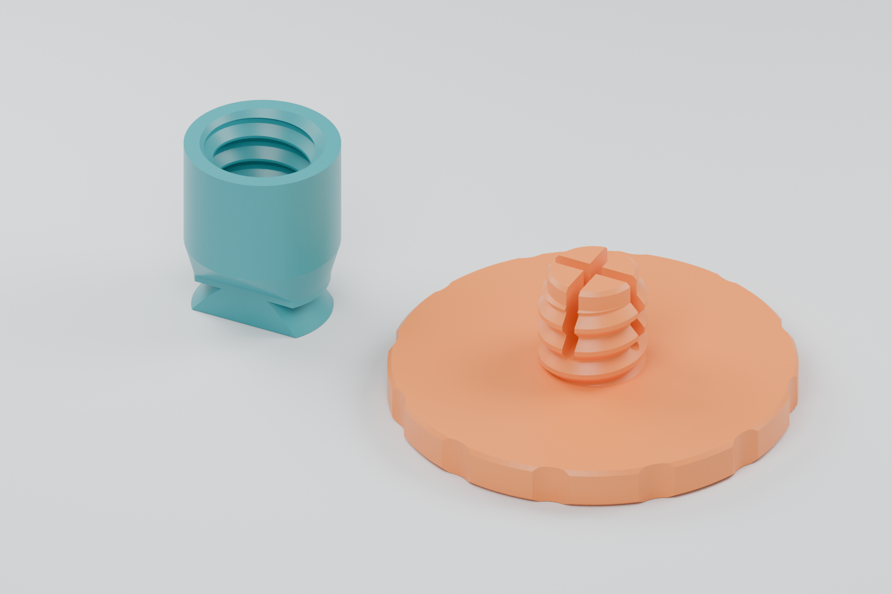
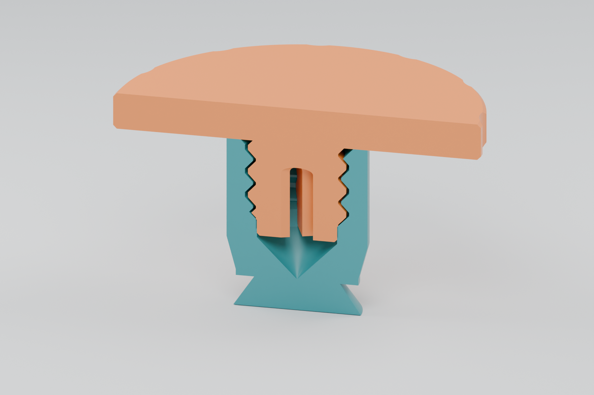
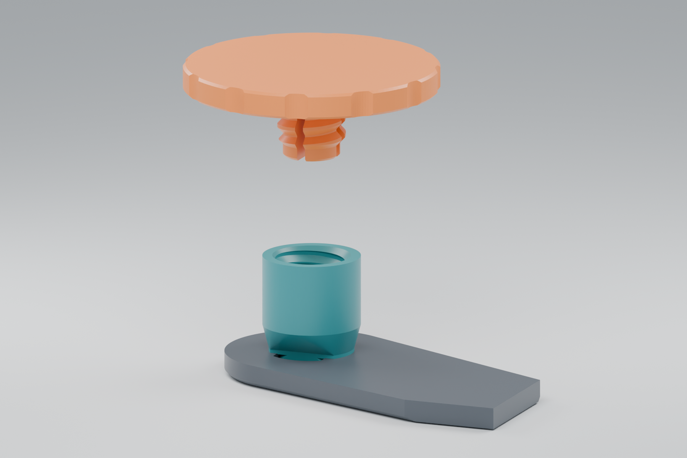

# Threaded reel-retaining thimble — prototype 01 (superseded)

**Historical design.** The user reported that the arm connector was too tight
and broke immediately, and that the reel needed 2 mm more axial space. The
screw mechanism worked well. Use the [integrated arm, prototype 02](README.md)
with the unchanged screw instead. The notes below record the original design
and validation; they do not establish a successful physical mounting fit.

Two printed parts replace the existing thimble's small reel-retaining lip with
a removable **30 mm diameter, 3 mm thick screw head**. Designed against this
repository's 8 mm feeder spool arm. The original feeder parts are unchanged.

**Prototype: geometry and slicing checked; physical fit, release torque,
long-term spring retention and transport behavior have not been tested. Print
one pair and test it before making a set.**

| Print one of each | File | Overall print dimensions |
|---|---|---|
| Hollow threaded thimble | [STL](stl/threaded-thimble-prototype-01.stl) | 11.5 × 11.5 × 14 mm |
| Retaining screw with grip scallops | [STL](stl/reel-retaining-screw-30mm-prototype-01.stl) | 30 × 30 × 11 mm; head is 3 mm thick |



The thimble is shown mouth-up here to reveal the threads. **Its STL is already
oriented mouth-down for printing.** The screw prints with its large head flat
on the bed and the threaded stem pointing up.

## Fit and retention

- The original quarter-turn key, V groove and upper mounting shoulder come
  directly from `cad/FDM/thimble.FCStd`. Both sides of the groove are retained
  so the arm is captured at the original axial position.
- The old outer reel lip is removed. A round 11.5 mm shaft replaces the
  original D-shaped reel-bearing shaft above the mounting shoulder. The
  repository's reel reference has a 13.3 mm hub bore, leaving 0.9 mm radial
  clearance. Other hub sizes require a physical check.
- Custom **8 mm diameter × 2 mm pitch**, single-start, right-hand threads use
  broad, truncated crests and approximately 45° printable flanks. These are
  a matched printed pair, **not an ISO M8 screw/nut interface**. Normal radial
  thread clearance is 0.25 mm; the body wall at the deepest thread is 1.5 mm.
- An 8 mm stem includes a 1.5 mm smooth pilot and thread lead-in. Two rounded
  slots divide the tip into four fingers. A 6.54 mm collar inside the thimble
  compresses the nominal 6.7 mm pilot by 0.08 mm per side near full engagement.
  This is intended to add friction against unwinding. The threads themselves
  retain running clearance; the interference is in the smooth pilot.
- The screw stops against the thimble's end face at the **original lip contact
  plane**, leaving room for the reference 10 mm wide reel to rotate. Its nose
  clears the conical bore end by about 0.37 mm. The head overlaps the reference
  hub opening by 8.35 mm radially.
- The larger heads remain clear of neighboring arms/thimbles at the 24 mm
  pitch of the five-feeder holder. Their diameters lie in parallel planes, so
  a 30 mm head does not require 30 mm feeder spacing. A 42 mm pitch was also
  screened; this does not establish compatibility with a different arm design.



This is a section of the actual STLs. The tip is shown in its undeformed CAD
shape; the small pilot/collar interference is intentional. The conical bore
end closes with printable slopes when the thimble is printed mouth-down.

## Printing and first fit

Use **unfilled PETG** as the starting material for the flexible pilot.
PETG's toughness, flexibility and layer adhesion suit this design intent;
see [Prusa's PETG material guidance](https://help.prusa3d.com/article/petg_2059).
Actual spring life still needs testing. PLA can be used to check shape, but
its retention behavior is not validated here.

- Keep the supplied STL orientations and print at 100% scale.
- Starting settings: 0.4 mm nozzle, 0.16 mm layers, four walls, five top and
  bottom layers, dense infill. Validation used 99% infill and no supports.
- Use your calibrated filament profile. Remove strings from the bore and the
  1 mm finger slots; keep the mount's V groove clean. A brim is optional if
  the thimble's annular bed contact does not adhere reliably.
- Fit the pair off the feeder first. Turn counterclockwise gently until the
  thread starts align, then screw in clockwise by hand. Expect increased
  resistance in approximately the last half-turn as the pilot enters its
  collar. Seat the head gently; do not use tools to force it.
- Align the key flats with the arm opening, insert fully, then turn a quarter
  turn to capture the arm. The shaft is round, so use the **key flats** for
  alignment instead of the old shaft flat. The original mounting mechanism
  is documented in [Opulo's spool-arm instructions](https://docs.opulo.io/feeders/4-mounting/mounting/).
- Check the thimble cannot pull straight out. Fit the reel and cap; check the
  reel still turns freely. Prevent the thimble itself from rotating when
  undoing the cap, since its original mount also releases with a quarter turn.
- Repeat several screw cycles and gently jostle the loaded assembly over a
  table to check retention. Check again after leaving the cap installed: the
  split pilot can wear or relax with time.

`radial_clearance` controls the free-running thread fit in [thimble.scad](thimble.scad).
`locking_interference` separately controls pilot compression. If the final
half-turn is too tight, reduce it from 0.08 to 0.04 mm and reprint the thimble;
if the ordinary threads bind, adjust the radial thread clearance instead.
Do not scale either part to tune fit, because that also changes the mounting
key, head size and thread pitch.



The gray arm is cropped from the repository assembly for this illustration.
The cap is lifted along its axis to show the screw and receiving bore.

## Reproduction and checks

From this directory:

```sh
# The checked-in mount reference allows a build without FreeCAD or Python CAD libraries.
python3 tools/build.py --legacy

# Refresh reference meshes from the saved FreeCAD BReps when needed.
uv run tools/export_reference.py
uv run tools/check_geometry.py

# Render the actual exported STLs.
blender --background --python tools/render.py
```

OpenSCAD with the Manifold backend is required. The thread surface is generated
in the SCAD source; no external thread library is required. CAD reference export
uses pinned OCP dependencies through `uv`, without recomputing the FreeCAD files.

Validation results are recorded in [validation.json](validation.json), including
STL hashes. Both STLs are single connected, watertight solids. They have no flat
undersides above the bed; downward surfaces are at least 45° from horizontal.
The original and replacement mount have the same overlap with the saved arm
geometry to within 0.00001 mm³ (the source assembly itself contains a small
nominal interference). A 17-position screw motion check found rigid overlap
only in the intended flexible pilot. The reference reel and neighboring arms
clear the new parts.

Bambu Studio slicing used an X1 Carbon 0.4 mm nozzle profile as a verification
example, with PETG, 0.16 mm layers, four walls and supports disabled. Printer
G-code is left in the ignored `generated/` directory; slice the STLs for your
own printer. Geometric checks and successful slicing are not physical tests.

Modified 2026-10-19 from the repository's Opulo thimble and spool-arm design.
The mount reference is a derived mesh of that design. Hardware remains under
the repository's [CERN-OHL-W v2 license](../../../LICENSE).
