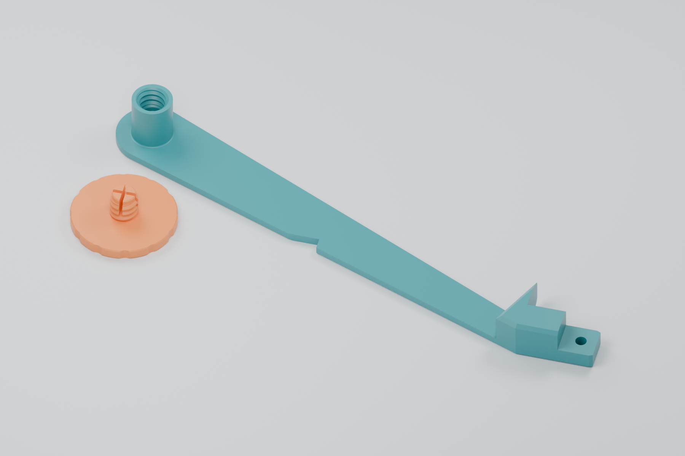
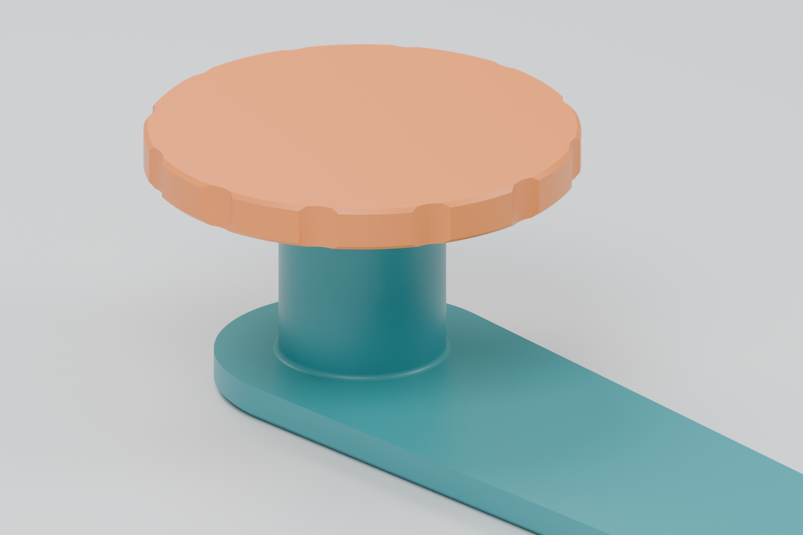
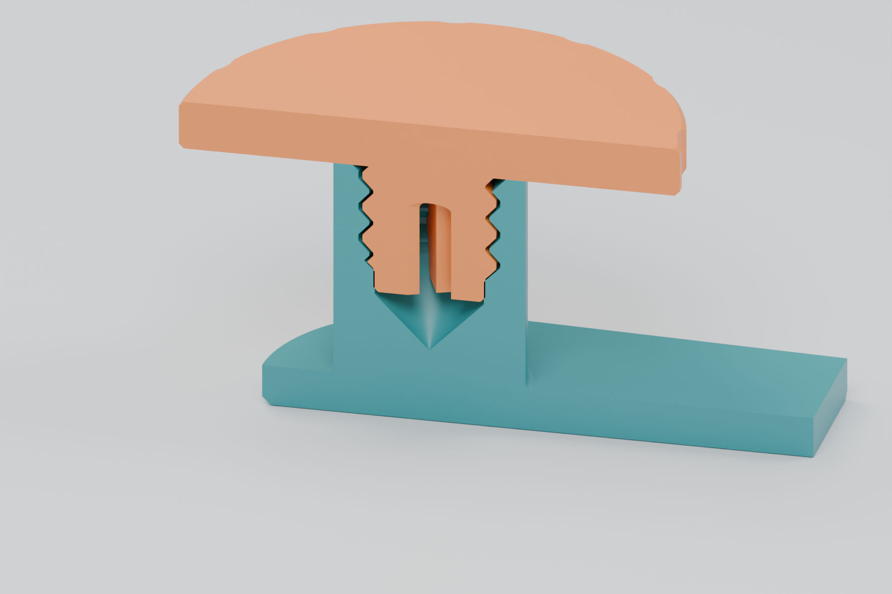

# Integrated spool arm and threaded thimble — prototype 02 (superseded)

**Physical feedback:** the integrated connection and screw worked well. The
user requested 1 mm less reel play and a stiffer arm for full reels. Use
[prototype 03](README.md) for the current reinforced version. The notes below
record this earlier revision; its STL is retained unchanged.

The thimble is now **part of the spool arm**, with **2 mm more usable reel
space**. This removes the detachable connector that broke during the user's
first fit test. The screw mechanism worked well, so its geometry and STL are
unchanged: **reuse the screw you already printed**.



| Part | File | Overall print dimensions |
|---|---|---|
| New arm with integral threaded thimble | [Print STL](stl/spool-arm-integrated-thimble-plus2mm-prototype-02.stl) | Approximately 150 × 65 × 15.9 mm |
| Existing retaining screw, unchanged | [STL if another is needed](stl/reel-retaining-screw-30mm-prototype-01.stl) | 30 × 30 × 11 mm; head is 3 mm thick |

**The new arm passes geometry and slicing checks; its physical fit and load
strength still need a print test.** The screw's successful physical test does
not establish the strength of the new integrated arm.

## What changed

- The old mounting socket and its locking grooves are filled through the
  arm's full thickness. The thimble merges directly into this solid backing;
  there is no quarter-turn key or narrow mounting neck.
- The spindle is 11.5 mm in diameter, with a small 0.4 mm root fillet. The
  fillet's maximum diameter is 12.3 mm, inside the reference reel's 13.3 mm
  hub bore, so it does not consume the added reel space.
- The cap seat and complete internal bore move outward together by 2 mm.
  Space between the arm face and the seated cap increases from **11.4 to
  13.4 mm**. A modeled 12 mm wide reel has 1.4 mm of axial play.
- The existing coarse thread, pilot collar and screw engagement are retained.
  The screw still has a **30 mm diameter, 3 mm thick head**. Its STL is
  byte-for-byte identical to the one the user tested.
- The rest of the original arm, including its feeder attachment, is retained.
  This revision uses the repository's 8 mm feeder spool arm.



The threads are a custom **8 mm major diameter × 2 mm pitch**, single-start,
right-hand printed pair, not an ISO M8 interface. Broad crests, approximately
45° flanks and 0.25 mm radial running clearance are unchanged. The screw's
split smooth pilot compresses against a collar near full engagement to resist
unwinding. This is the same retention feature as prototype 01.



The section is cut from the actual exported STLs. The pilot is shown in its
undeformed shape; its small collar interference is intentional.

## Printing and installation

- Print the new arm at **100% scale with its long flat back on the bed and
  the thimble opening pointing up**, as supplied in the STL. No supports are
  needed in the checked print layout.
- Use unfilled PETG as the starting material. The previous cap's material
  guidance remains applicable; see [Prusa's PETG guidance](https://help.prusa3d.com/article/petg_2059).
- Starting settings: 0.4 mm nozzle, 0.16 mm layers, four walls, five top and
  bottom layers, and dense infill. The slicing check used 99% infill with
  supports disabled. Use a calibrated profile for your own printer.
- If printing another screw, keep its large head flat on the bed and its
  stem pointing up. The supplied screw STL already has this orientation.
- Replace the existing spool arm with this integrated part using the feeder's
  existing arm attachment. There is no thimble connector to press or twist in.
- Remove any strings from the bore. Start the existing screw gently and seat
  it by hand; the final part of the turn should engage the retention pilot.
  Do not force a binding thread with tools.
- Fit a reel, confirm it rotates freely with the cap seated, and check the
  loaded arm and retention over a table before moving a feeder around.

The original source arm has approximately 45° chamfers. Mesh checks found no
flat downward faces above the bed and a minimum practical underside angle of
44.5° from horizontal. Neighboring feeder spacing was excluded from this
revision's checks at the user's request.

## Source and reproduction

[integrated-arm-prototype-02.scad](integrated-arm-prototype-02.scad) builds the new arm from the saved
arm mesh and imports the unchanged bore from [thimble.scad](thimble.scad).
`spindle_extension = 2` controls the extra usable reel width. The checked-in
[arm reference](reference/spool-arm.stl) permits a build without FreeCAD.

From this directory:

```sh
# Build the integrated arm and the unchanged screw.
python3 tools/build.py --prototype 02

# Refresh reference meshes only when the upstream CAD has changed.
uv run tools/export_reference.py

# Historical geometry checks and rendering scripts are available at commit 60495d8.
# Current check/render commands target prototype 03.
```

OpenSCAD with the Manifold backend is required. Reference export reads the
saved FreeCAD BReps with pinned OCP dependencies through `uv`; it does not
recompute the FreeCAD files. STL export discards only exactly zero-area
facets caused by float32 rounding at the original arm's bottom plane.

[validation-prototype-02.json](validation-prototype-02.json) records file
hashes and validation results. The arm is one connected, watertight solid.
Checks confirm the filled socket, continuous spindle root, preserved arm
geometry, translated bore, unchanged screw, 17 positions through the final
screw turn, and clearance for a 177 mm diameter reel with a 13.3 mm bore and
12 mm width. These are geometric checks, not load or fatigue tests.

Bambu Studio sliced the new arm with an X1 Carbon 0.4 mm nozzle profile as a
verification example. No supports were generated. Machine-specific G-code
remains in the ignored `generated/` directory; slice the STL for your printer.

The [superseded detachable design](prototype-01.md), its STLs and
[original validation](validation.json) remain for history. Use
`python3 tools/build.py --legacy` only to reproduce that version.

Modified 2026-10-19 from the repository's Opulo thimble and spool-arm design.
Hardware remains under the repository's [CERN-OHL-W v2 license](../../../LICENSE).
