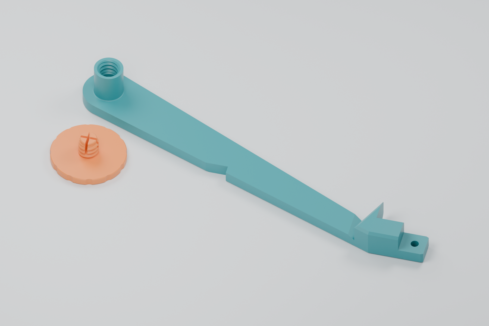
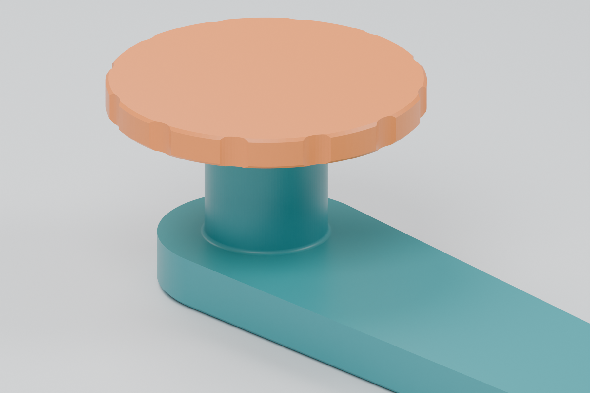
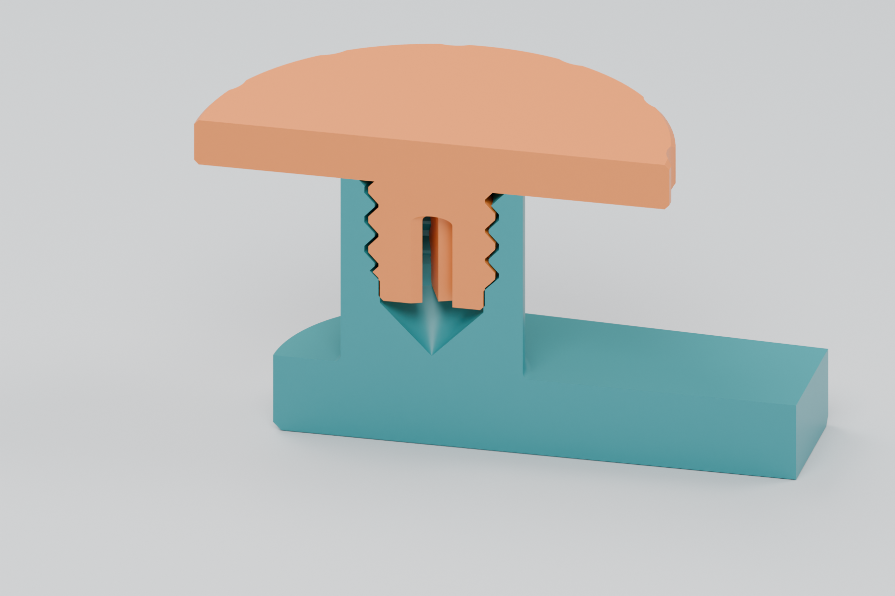

# Reinforced spool arm and threaded thimble — prototype 03 (superseded)

**Superseded:** the user clarified that the bump-out is a cover-tape guard
and requested a continuous 4 mm arm right up to it, with no thin transition.
Use [prototype 04](README.md). These notes describe the earlier 5 mm arm
with a tapered neck; its source, STL and validation remain for history.

This revision **shortens the usable thimble length by 1 mm** and **doubles the
free arm's thickness from 2.5 to 5 mm** to reduce flex with a full reel. The
integrated connection worked in the user's physical test; this update addresses
excess reel play and arm wobble. **Reuse the existing retaining screw.**



| Part | File | Overall print dimensions |
|---|---|---|
| Reinforced arm with integral threaded thimble | [Print STL](stl/spool-arm-reinforced-integrated-thimble-prototype-03.stl) | Approximately 150 × 65 × 17.4 mm |
| Existing retaining screw, unchanged | [STL if another is needed](stl/reel-retaining-screw-30mm-prototype-01.stl) | 30 × 30 × 11 mm; head is 3 mm thick |

Geometry, assembly clearance and slicing checks pass. The revised arm's loaded
stiffness and the reduced reel clearance still need a physical print test.

## Reel fit and arm reinforcement

- **12.4 mm usable reel space**, down from 13.4 mm in prototype 02. The complete
  threaded bore, pilot collar and cap seat move together, retaining the same
  screw engagement. A modeled 12 mm wide reel has 0.4 mm total axial play;
  the actual clearance depends on the reel and printing accuracy.
- **5 mm thick free span**, up from 2.5 mm. Reinforcement follows the existing
  arm outline and notch, extends from the thimble end toward the feeder, and
  tapers back over the final 5 mm before the preserved attachment region.
  This adds material to resist bending; no measured stiffness multiplier is
  claimed.
- The added thickness is on the reel side, retaining the flat print underside.
  The reel contact face moves outward by 2.5 mm; the seated cap moves outward
  by 1.5 mm. Their separation therefore decreases by exactly 1 mm. Overall
  part height increases even though the exposed thimble becomes shorter.
- The original feeder attachment, including the screw hole and locating
  features beyond native X = 114 mm, is unchanged. Added material clears the
  nearby gears and motor in the saved 8 mm feeder assembly position.
- The spindle remains 11.5 mm in diameter with a 0.4 mm root fillet. Its maximum
  root diameter is 12.3 mm, inside the reference reel's 13.3 mm hub bore. The
  former detachable socket remains filled through the arm.
- The screw STL is byte-for-byte identical to the physically tested screw.
  It retains its **30 mm diameter, 3 mm thick head**, coarse thread and split
  pilot retention feature.



The threads remain a custom **8 mm major diameter × 2 mm pitch**, single-start,
right-hand printed pair, not an ISO M8 interface. Thread clearance and the
pilot/collar interference are unchanged; shortening adjusts reel play, not
thread tightness.



These renders use the actual STL geometry. The section shows the split pilot
in its undeformed shape; its small collar interference is intentional.

## Printing and installation

- Print the new arm at **100% scale, long flat back on the bed and thimble
  opening upward**, as supplied. The checked layout needs no supports.
- Keep the same calibrated PETG material profile used for the earlier design.
  Starting settings are a 0.4 mm nozzle, 0.16 mm layers, four walls, five top
  and bottom layers, and dense infill. Validation used 99% infill.
- If another screw is needed, print its large head flat on the bed, with the
  stem pointing upward. The supplied screw STL already has that orientation.
- Replace the previous spool arm using the existing feeder attachment. Clean
  any strings from the bore and seat the existing screw gently by hand.
- Check that the reel turns freely with the cap seated. Compare loaded arm
  flex with the previous print and check retention over a table before moving
  feeders around. Do not force the cap if a wider reel becomes clamped.

Neighboring feeder spacing remains outside this revision's scope, as requested.
Assembly checks cover the saved position; they do not establish clearance
through every moving part's travel or under loaded deflection.

## Source and reproduction

[integrated-arm-prototype-03.scad](integrated-arm-prototype-03.scad) adds reinforcement to the saved arm
mesh and uses the tested bore from [thimble.scad](thimble.scad).
`spindle_extension = 1` specifies usable space relative to the original
11.4 mm baseline; `reinforcement_height = 2.5` adds arm thickness separately.
The checked-in [arm reference](reference/spool-arm.stl) permits an OpenSCAD
build without FreeCAD.

From this directory:

```sh
python3 tools/build.py --prototype 03
# Historical check and render scripts are available at commit 19e88c6.
# Current check/render commands target prototype 04.
```

OpenSCAD with the Manifold backend is required. Reference export reads saved
FreeCAD BReps using pinned OCP dependencies through `uv`. Refresh the arm mesh
with `uv run tools/export_reference.py` only when its source CAD changes.
The STL builder removes exactly zero-area export facets without moving vertices.

[validation-prototype-03.json](validation-prototype-03.json) records STL hashes,
geometry measurements, assembly checks and slicing results. Checks cover one
connected watertight solid, print orientation, practical overhangs, preservation
of the feeder attachment, beam thickness at six sections, exactly 1 mm less
reel space, unchanged screw geometry, 17 screw positions and a 12 mm wide reel.
Float32 sliver faces narrower than 0.00001 mm are excluded from the overhang
angle calculation; their total area is separately bounded and recorded.

Bambu Studio sliced the arm using an X1 Carbon 0.4 mm nozzle profile, PETG and
supports disabled. No support paths were generated. Machine-specific G-code
and expanded profiles stay in ignored `generated/`; slice the STL for your printer.

## Previous versions

- [Prototype 02](prototype-02.md): integrated thimble, 13.4 mm reel space and
  original 2.5 mm arm. Its physical test prompted this revision. Its STL and
  source are retained; reproduce with `python3 tools/build.py --prototype 02`.
- [Prototype 01](prototype-01.md): superseded detachable thimble. The connector
  failed the physical fit test; its screw remains current. Reproduce with
  `python3 tools/build.py --legacy`.

Modified 2026-10-20 from the repository's Opulo thimble and spool-arm design.
Hardware remains under the repository's [CERN-OHL-W v2 license](../../../LICENSE).
