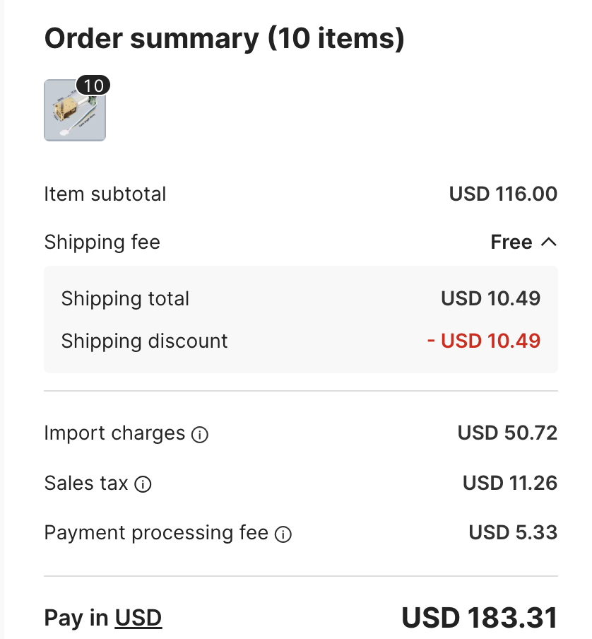

# Feeder motor sourcing

Recorded October 16, 2026. Intended quantity: 10–50 feeder motors, with flexible delivery.

At the observed checkout price, prefer the Opulo kit. Ten imported drive motors cost **$183.31 total, or $18.33 each**, while Opulo lists a kit with both motors, the drive wheel (index wheel), and compatible harnesses for **$19.95 before its own tax and shipping**. Keep the direct motor sources below for another quote if import charges fall.

## Motor specification

The tape drive uses a right-angle N20 gear motor with an encoder. The separate peel motor removes cover film. The target configuration below combines the [feeder BOM](../bom.csv), [design decisions](../DESIGN_DECISIONS.md), supplier listings, and saved reference images.

| Item | Specification and ordering detail |
|---|---|
| Drive motor family | Chihai **CHF-GW12T-N20ABHL**, brushed DC motor with a right-angle metal worm gearbox and rear Hall encoder. The reference images also abbreviate the name as CHF-GW12-N20 ABHL. |
| Drive gearbox | **1030:1** reduction. Select the option labeled `ratio 1030` or `ratio 1:1030`. The other ratios offered on the same pages are different configurations. |
| Motor winding | Target **12 V**, labeled `DC12V A35` on the supplied AliExpress listing and `DC12V 35` on Alibaba. The original feeder design operates the motor from approximately 10 V and the encoder from 3.3 V. |
| Encoder | Installed **AB dual-channel incremental Hall encoder**, with its magnet and six-wire cable included. Seller material calls it **7 PPR at the motor shaft**; the feeder design calls for **14 ticks per motor revolution**, or 14,420 ticks per output revolution at 1030:1. Confirm the pulse/edge counting convention with a sample before assuming firmware compatibility. |
| Encoder supply | Supplier reference sheet lists **3.3 V or 5 V**. Request confirmation of 3.3 V operation for the feeder. This is separate from the 12 V motor supply. |
| Standard output shaft | **3 mm D shaft**, approximately **7.5–8 mm exposed length**. Chihai's product page says 7.5 mm; the Alibaba attributes observed during sourcing say 8 mm. Confirm the supplied drawing. |
| Gearbox dimensions | Reference image labels **18 × 12 × 10 mm**. It separately labels the motor body 15.3 mm and rear encoder section 7.5 mm. Mounting-hole spacing must come from a drawing or sample. |
| Peel motor | Separate straight-output N20 motor, **210:1** reduction; the BOM links a ServoCity 110 RPM motor. The right-angle motor listings do not include this second motor. |

The [manufacturer's product page](https://www.airsoftmotor.com/encoder-motor/gear-reduction-motor-with-encoder/micro-n20-turbo-worm-geared-motor-with-7ppr.html) identifies the encoder-equipped model and standard shaft. The [saved dimensions image](assets/feeder-motors/chihai-dimensions-reference.png) and [encoder sheet](assets/feeder-motors/chihai-encoder-pinout-reference.png) preserve the supplied specifications.

## Supplier URLs and observed prices

These are October 16, 2026 observations, not future quotes. Recheck the selected voltage, gearbox, encoder inclusion, quantity, and final checkout total before ordering.

| Source | URL | Observed price and useful detail |
|---|---|---|
| Chihai through Alibaba | [CHF-GW12T-N20ABHL, product 1600830721254](https://www.alibaba.com/product-detail/ChiHai-Motor-CHF-GW12T-N20ABHL-DC_1600830721254.html) | Shenzhen Chihai Motor Co., Ltd. Listed **$11.60 each for 1–99**, $10.80 for 100–999, and $7.50 for 1,000+. Shipping, import charges, sales tax, and processing are additional or calculated at checkout. The ten-motor checkout below starts at $11.60 each. |
| AliExpress listing supplied by the user | [CHF-GW12T-N20ABHL, item 3256807896269297](https://www.aliexpress.us/item/3256807896269297.html) | Listed **$16.65**, with an extra 5% off at 10+ pieces, approximately $15.82 each before other charges if the discount applies. Select `ratio 1030` and `DC12V A35`. |
| Original feeder BOM source | [Right-angle N20 with encoder, item 3256805361367595](https://www.aliexpress.us/item/3256805361367595.html) | The URL in the repository BOM. The page showed **$16.61** for its initially displayed 603:1, 12 V selection; that is not a verified price for the required 1030:1 configuration. Re-select the correct ratio before comparing. |
| Chihai manufacturer page | [Micro N20 worm motor with 7 PPR encoder](https://www.airsoftmotor.com/encoder-motor/gear-reduction-motor-with-encoder/micro-n20-turbo-worm-geared-motor-with-7ppr.html) | Product details and direct quote contact: **sales@chihaimotor.cn**. |
| Opulo kit | [Feeder Motors and Drive Wheel](https://www.opulo.io/products/feeder-part-kit) | **$19.95 per kit**, before tax/shipping. Includes shortened-shaft drive motor with flush encoder PCB and harness, peel motor with harness, and drive wheel with aligned shortened shaft collar. The page stated an estimated **two-week lead time**. |
| Separate peel motor from the BOM | [ServoCity 110 RPM Micro Gear Motor](https://www.servocity.com/110-rpm-micro-gear-motor/) | Saved as the BOM's alternative peel-motor source; current price and availability were not checked. Confirm the 210:1 motor and required voltage when sourcing separately. |

The user-supplied AliExpress listing's only review visible during sourcing was dated **September 26, 2026**. The buyer reported receiving two motors without encoders despite ordering an encoder-equipped product. This is one buyer's report, but it makes written confirmation and a photograph of the supplied assembly useful before placing a batch order.

## Actual checkout for ten drive motors

The [saved checkout screenshot](assets/feeder-motors/alibaba-checkout-10-motors-2026-10-16.png) shows:

| Charge | USD |
|---|---:|
| Item subtotal, 10 × $11.60 | $116.00 |
| Shipping before discount | $10.49 |
| Shipping discount | −$10.49 |
| Net shipping | $0.00 |
| Import charges | $50.72 |
| Sales tax | $11.26 |
| Payment processing fee | $5.33 |
| **Total payable** | **$183.31** |
| **Total per drive motor, rounded** | **$18.33** |

Import charges, sales tax, and processing add **$67.31 per order**, or **$6.73 per motor**, above the item price. The screenshot labels $50.72 as “Import charges”; it does not establish a statutory tariff rate or break that charge into its components.

Ten Opulo kits have a **$199.50 subtotal before Opulo's own tax and shipping**. A complete comparison must use the final checkout total for both choices and include the peel motors, drive wheels, harnesses, and any shaft/encoder modifications required when buying the drive motors separately. At the observed $18.33 per imported drive motor, the kit is the preferred value for this batch.

## Mechanical fit and wiring

The [Opulo kit](https://www.opulo.io/products/feeder-part-kit) uses a shortened drive shaft, flush encoder PCB, and shortened wheel collar to keep the feeders thin enough for the full 50-feeder arrangement. The standard Chihai assembly is a candidate for a DIY feeder, but its shaft projection, encoder PCB projection, wheel/collar fit, and overall feeder spacing need to match the intended build. “N20” alone does not establish those dimensions.

Both marketplaces offer separate `1030 steel plate` options. The reference motor has brass-colored gearbox plates, and the BOM does not specify the steel-plate variant. Request the matching construction and dimensions rather than treating those options as interchangeable.

The supplier encoder sheet calls the connector **ZH1.5-6PIN**. The [feeder harness drawing](../cad/CHA/drive-motor/drive-motor.yml) specifies the **Molex PicoBlade** family and references **53261-0671**, the six-circuit PCB header. [Molex lists that header's mating pitch as 1.25 mm](https://www.molex.com/en-us/products/part-detail/532610671). Request a cable plug that mates with the actual feeder header; do not order the PCB header as the cable connector.

| Feeder connector pin | Signal in feeder harness | Wire color in supplier sheet | Supplier function |
|---|---|---|---|
| 1 | M1 | White | Motor terminal labeled + |
| 2 | GND | Blue | Hall sensor ground |
| 3 | C1 | Green | Hall channel A |
| 4 | C2 | Yellow | Hall channel B |
| 5 | VCC | Black | Hall sensor supply |
| 6 | M2 | Red | Motor terminal labeled − |

Confirm connector orientation against the header drawing; the order above is electrical pin numbering, not a viewing direction. In particular, the supplier sheet uses **black for encoder VCC and blue for ground**. The feeder harness drawing calls for 100 mm of cable, while the supplier dimension image labels its cable 40 mm; specify the needed length.

## Revisit if import charges fall

If only the **$50.72 import charge** disappeared and every other checkout line stayed fixed, the ten-motor total would become **$132.59**, or **$13.26 per motor**. This is a subtraction scenario, not a future quote: tax, processing, shipping discounts, and item prices may also change.

When revisiting, obtain fresh totals for 10, 25, and 50 units with the exact 12 V, 1030:1, encoder-equipped configuration. Compare:

`imported drive motor landed cost + peel motor + drive wheel/collar + compatible harnesses + any adaptation cost`

against the **landed cost of one Opulo kit**. A lower duty/import charge makes the direct sources worth another look; it does not by itself establish a cheaper complete feeder parts set.

Before the full batch, order 2–3 samples and check shaft/PCB fit, connector pinout, 3.3 V encoder signals, counts per revolution, and feeding with the intended controller and firmware.

Suggested quote request:

> Please quote 10, 25, and 50 CHF-GW12T-N20ABHL motors with 12 V A35 winding, 1030:1 right-angle metal gearbox, installed AB Hall encoder and magnet, and six-wire cable. Confirm 3.3 V encoder operation and the 7 PPR pulse/edge counting convention. Please provide a dimensioned drawing and photographs of the exact supplied assembly, including output shaft length and encoder PCB projection. Quote a 100 mm harness with a mating plug for the six-pin Molex PicoBlade 1.25 mm feeder header, wired M1/GND/A/B/VCC/M2. Itemize unit price, shipping, import charges, tax, processing fees, and lead time. Also state whether a shortened shaft and flush encoder PCB matching the Opulo assembly are available.

## Saved reference images

The original images supplied in this conversation are preserved beside this note:

- [Opulo drive motor reference](assets/feeder-motors/opulo-drive-motor-reference.png)
- [Chihai model and encoder reference](assets/feeder-motors/chihai-model-reference.png)
- [Dimensions and cable length](assets/feeder-motors/chihai-dimensions-reference.png)
- [Right-angle worm gearbox](assets/feeder-motors/chihai-gearbox-reference.png)
- [AliExpress listing with 1030 and 12 V selections](assets/feeder-motors/aliexpress-listing-2026-10-16.png)
- [Encoder specifications and wire colors](assets/feeder-motors/chihai-encoder-pinout-reference.png)
- [D shaft reference](assets/feeder-motors/chihai-d-shaft-reference.png)
- [Ten-motor checkout with import charges](assets/feeder-motors/alibaba-checkout-10-motors-2026-10-16.png)
